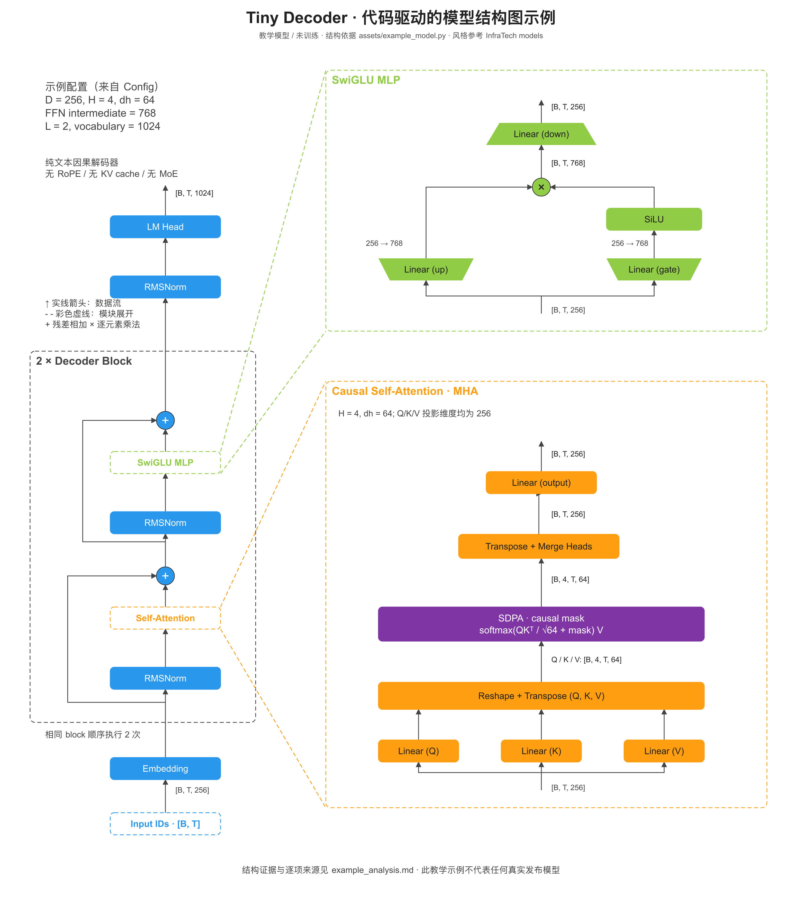

# Future_skill

可复用的 Codex 技能集合。

## 模型结构分析与绘图

[`model-architecture-diagram`](model-architecture-diagram/SKILL.md) 从模型代码、仓库、配置或技术报告还原计算路径，生成参考 [InfraTech/models](https://github.com/CalvinXKY/InfraTech/tree/main/models) 的模型结构图。

技能包含代码分析流程、源图风格研究、纯 Python SVG 渲染器和原生 draw.io 导出器，以及可复现的源码—结构描述—证据表—图片示例。支持整体骨架、Attention、FFN/MoE、多模态前端等不同层级；图中的结构以当前模型证据为准。



### 安装

将 `model-architecture-diagram` 文件夹放到 Codex 的技能目录（通常为 `~/.codex/skills/`，或自定义 `$CODEX_HOME/skills/`）。已有同名技能时先比较内容，避免覆盖本地修改。本仓库未自动修改你的全局技能目录。

### 调用示例

```text
使用 $model-architecture-diagram 分析这个仓库中的模型实现：<仓库 URL 或本地路径>。
选择 <模型变体/配置/revision>，绘制 InfraTech 风格的整体架构及核心模块展开图，
输出 PNG、可编辑 SVG 和 draw.io 文件、绘图描述和带源码行号的结构分析。
```

```text
使用 $model-architecture-diagram，根据 <技术报告 PDF/URL> 绘制模型结构图。
把报告中确认的信息和推导分开，标注页码；没有公开的实现细节不要补造。
```

### 本地验证与示例生成

```bash
cd model-architecture-diagram
python3 -m unittest discover -s tests -v
python3 scripts/render_diagram.py assets/example.architecture.json --output example.svg
```

SVG 生成与测试仅依赖 Python 3 标准库。PNG 导出使用可选的 CairoSVG、sharp 或其他现有工具，见 [格式与导出说明](model-architecture-diagram/references/diagram-format.md)。示例源模型只用于展示结构分析，不需要下载权重；未训练，未声称运行性能。

上游二维图未提供独立作图规范，本技能明确把图中观察与新增制作约定分开；固定参考版本及样本链接见 [风格研究](model-architecture-diagram/references/infratech-style.md)。示例与工具为重新制作，未打包上游图片或作者标识。
